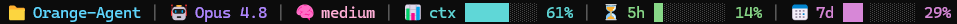

# claude-statusline

A compact, colorful status line for [Claude Code](https://claude.com/claude-code):



Six segments, divided by vertical bars, each with its own 256-color accent:

- 📁 **folder** — the current working directory's name
- 🤖 **model** — the active model's display name (adds `1M` for a 1M-context model, `fast` in fast mode)
- 🧠 **effort** — the reasoning effort level (shown only when the model reports one)
- 📊 **ctx** — context-window usage, with a gauge bar
- ⏳ **5h** — the 5-hour rate-limit window usage, with a gauge bar
- 📅 **7d** — the 7-day rate-limit window usage, with a gauge bar

The filled part of each bar is what's used; the empty part is what's left. When a
value climbs past 75% the segment turns orange, past 90% red. Segments drop from
the right when the terminal is too narrow to fit them all; the folder always stays.

## Requirements

- Claude Code
- Python 3.6 or newer on your `PATH`
- The **5h** and **7d** segments only appear on subscription accounts, which is
  where Claude Code includes the `rate_limits` field in the status-line data.

## Install

This repository works two ways: install it as a Claude Code plugin, or clone it
and run the installer directly. Both set up the same status line.

### Option 1 — as a plugin

```
/plugin install statusline-gauge --marketplace r00tdr4g0n/claude-statusline
/statusline-gauge:setup
```

`/plugin install` adds the plugin (press `y` to add the marketplace, choose the
**user** scope). `/statusline-gauge:setup` then runs the bundled installer that
copies the script and configures `statusLine`. Restart Claude Code to see it.

### Option 2 — clone and install

```
git clone https://github.com/r00tdr4g0n/claude-statusline
cd claude-statusline
python install.py        # Windows
python3 install.py       # macOS / Linux
```

Either way the installer copies `statusline-command.py` into `~/.claude/`, backs
up your `~/.claude/settings.json`, and sets its `statusLine` entry to run the
script with the Python you launched it with. Restart Claude Code (or open a new
session) to see it.

### Manual install

Copy `statusline-command.py` into `~/.claude/`, then add to `~/.claude/settings.json`:

```json
{
  "statusLine": {
    "type": "command",
    "command": "python3 ~/.claude/statusline-command.py"
  }
}
```

Use `python` instead of `python3` on Windows.

## Customizing

Everything tunable sits at the top of `statusline-command.py`:

- `ICON_*` — the per-segment icons (swap the emoji for one-cell glyphs if you
  prefer; the width is measured automatically).
- `COLOR_*` — the 256-color index for each segment.
- `ALERT_STEPS` — the thresholds and colors that override a segment's own color
  as usage climbs.
- `BAR_WIDTH` — how many cells each gauge bar takes.

After editing, no reinstall is needed if you edited the copy in `~/.claude/`; just
start a new session.

## License

MIT
